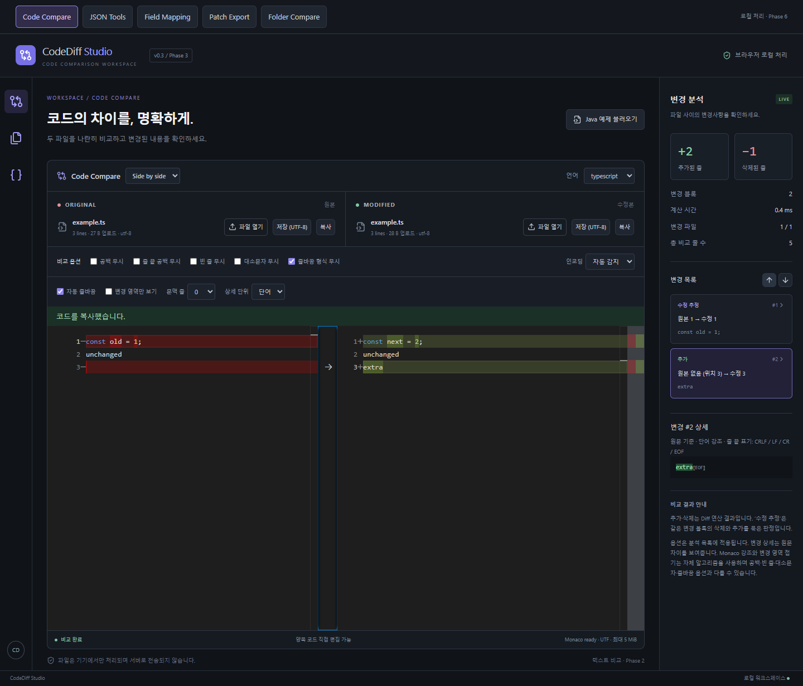
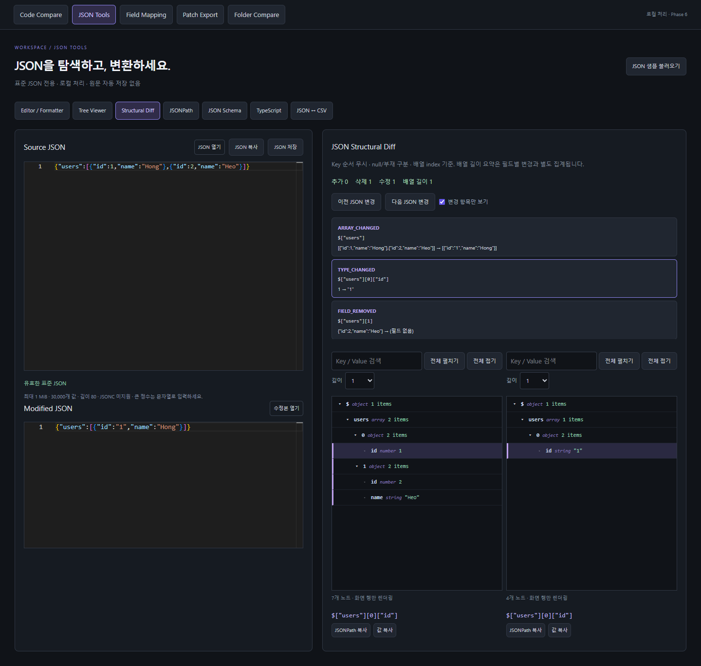
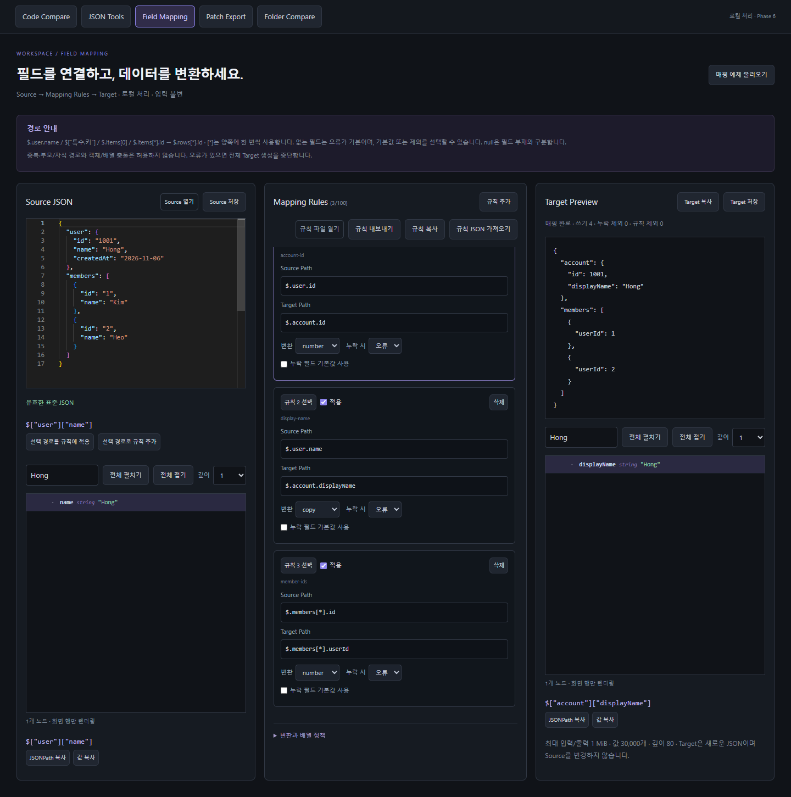
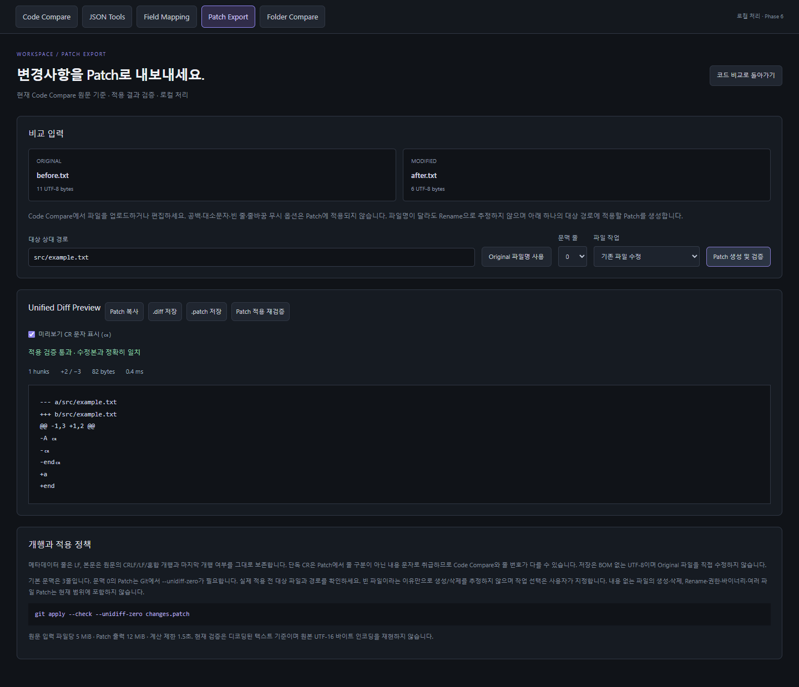
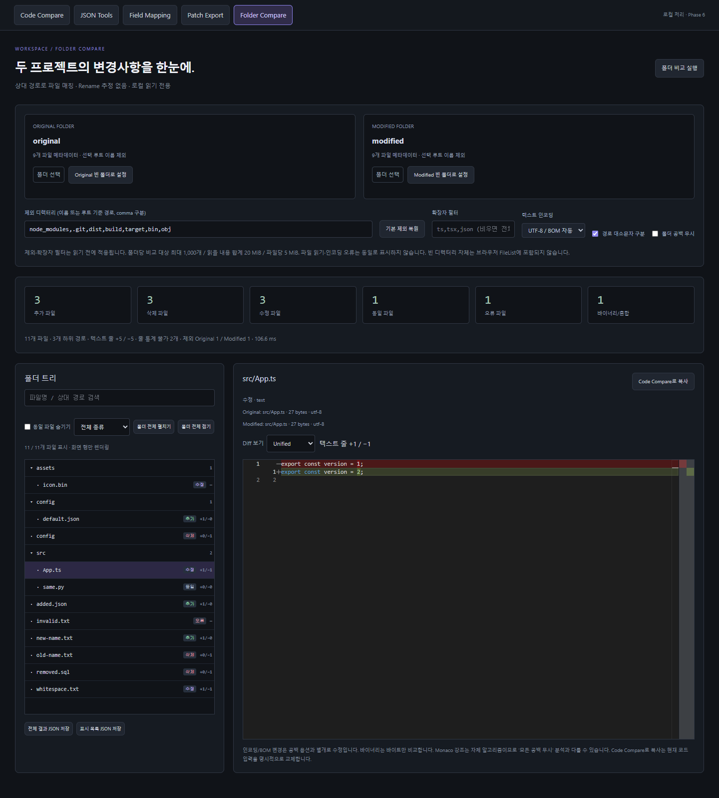
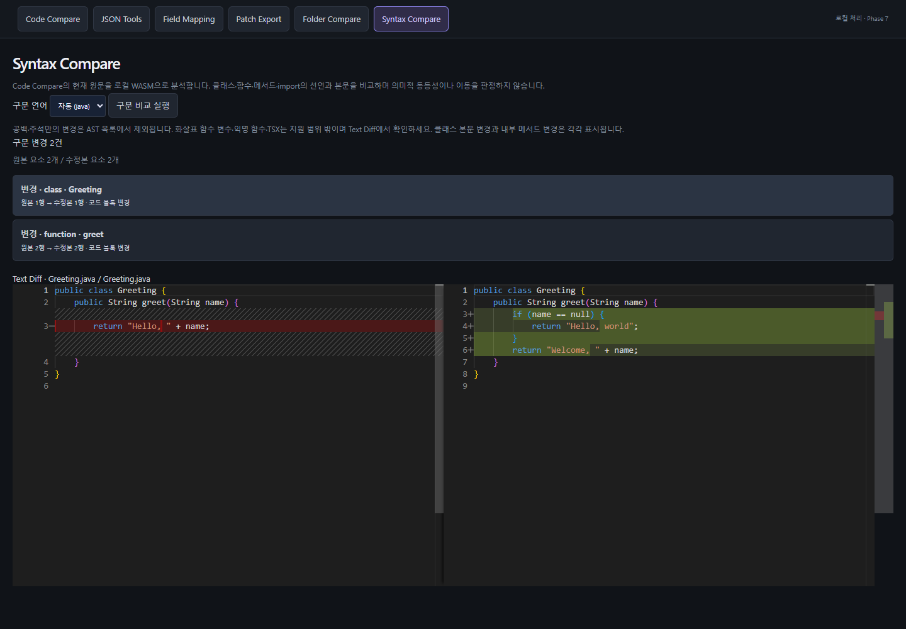
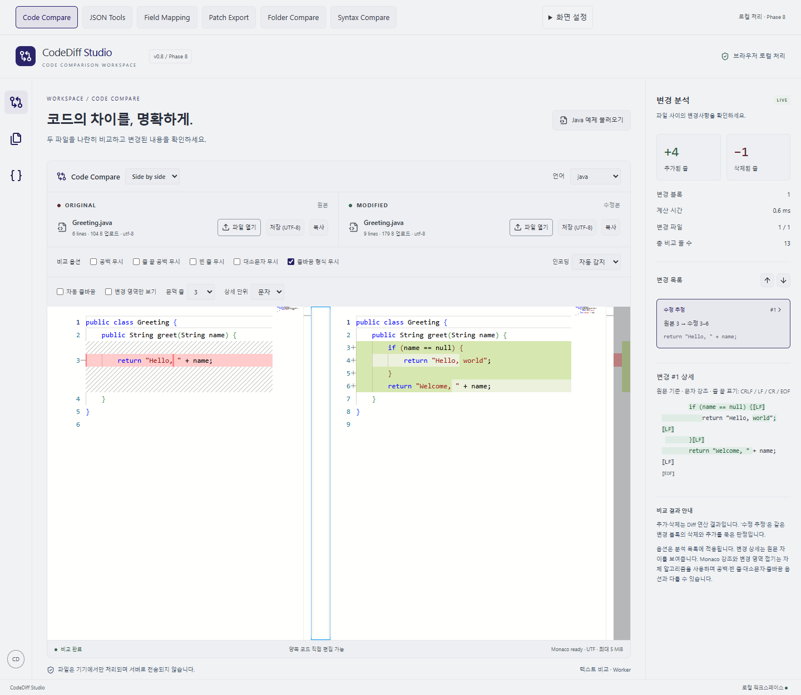

# CodeDiff Studio

브라우저에서 소스 코드 비교·JSON 분석·필드 매핑을 로컬로 수행하는 React + TypeScript 개발 도구. 검증 완료 범위는 **Phase 0–8**입니다. 전체 요구사항은 [PROJECT.md](PROJECT.md)를 참고하세요.

## 실행

Node.js 22.12+ 권장 (검증 환경 24.12.0).

```sh
npm ci
npm run dev
npm test
npm run typecheck
npm run lint
npm run build
```

## 구현 기능

- Monaco Side-by-Side / Unified Diff 전환, Side-by-Side 양쪽 편집, Unified 수정본 편집, 언어별 구문 강조·줄 번호·줄 내부 변경 표시
- 두 파일 업로드, 각 파일 영역 Drag & Drop, 직접 편집, Java 예제
- 언어 자동 감지 및 수동 선택, UTF8/BOM/UTF16 LE·BE 디코딩
- 변경 블록 목록과 위치 이동, 추가·삭제 연산 수, 수정 추정 표시
- 공백·줄 끝 공백·빈 줄·대소문자·줄바꿈 분석 옵션, 250ms debounce
- 선택 변경의 원문 단어/문자 강조 및 CRLF/LF/CR/EOF 표기
- 자동 줄바꿈, 동일 영역 접기와 문맥 줄 수 선택
- 각 편집본 복사·UTF-8 다운로드, 변경 파일·총 비교 줄 수 통계
- 바이너리·잘못된 인코딩·5 MiB 초과 업로드 오류 표시
- JSON Editor/Formatter, 가상화 Tree Viewer, Structural Diff, JSONPath, Schema, TypeScript, JSON ↔ CSV
- Field Mapping: 경로 선택·이름 변경·타입 변환·기본값·상수·배열·규칙 입출력
- 원문 기반 Unified Patch 생성·적용 검증·미리보기·복사·.diff/.patch 저장
- Folder Compare: 실제 폴더 선택·상대 경로 매칭·가상 트리·파일별 Diff·통계·메타데이터 보고서
- Code Compare / JSON Tools / Field Mapping / Patch Export / Folder Compare 작업 공간 전환 및 메모리 상태 유지
- 한국어 Dark/Light UI, MiniMap, 패널 크기 조절, 키보드 설정·본문 이동, 모바일 Unified 기본 보기. 파일·코드는 외부로 전송하거나 영구 저장하지 않습니다.

## 비교 방법

Original/Modified의 파일 열기 또는 각 영역 드롭으로 두 파일을 선택하세요. 언어는 마지막 업로드 파일 기준이며 수동 변경할 수 있습니다. 편집기 양쪽에서 직접 입력할 수 있고 변경 목록을 클릭하거나 화살표를 사용하면 해당 줄로 이동합니다. Ctrl/Cmd+F 검색과 선택 복사는 Monaco 기본 기능을 사용합니다. 업로드 인코딩 변경 후 파일을 다시 선택하세요.

Java, C#, Python, Go, Kotlin, Rust, C/C++, HTML, CSS, SCSS, JS/JSX, TS/TSX, Vue, SQL, JSON/JSONL, XML, YAML, Properties/INI/CONF/ENV, TXT/Markdown/LOG, Shell/PowerShell/Batch 등 텍스트를 지원합니다. 알 수 없는 확장자는 Plain Text입니다. Vue는 HTML 강조, JSONL은 Plain Text입니다. 바이너리·PDF·Word·이미지 비교는 지원하지 않습니다.

## 아키텍처와 제약

[ARCHITECTURE](docs/ARCHITECTURE.md), [설계 결정](docs/DECISIONS.md), [진행 상황](docs/PROGRESS.md), [테스트](docs/TEST-CASES.md).

jsdiff 원문 줄 토큰에 비교 옵션을 적용하고 실제 원문은 보존합니다. 수정은 같은 블록의 삭제·추가를 묶은 추정이며 이동 감지는 없습니다. Monaco 시각 강조와 분석 엔진은 독립적입니다. Monaco 공백 무시는 줄끝 공백 기준이며 분석 목록의 모든 공백 무시, 대소문자/EOL 옵션과 다를 수 있습니다. 빈 줄 무시 역시 분석 목록에 적용되며, 변경 상세는 원문을 표시합니다. 변경 영역 접기는 Monaco 결과 기준입니다. 화면에도 이를 안내합니다.

업로드 크기 정보는 업로드 시점 바이트 수입니다. BOM 없는 UTF16은 수동 선택해야 합니다. 각 파일의 저장 (UTF-8)은 현재 편집본을 BOM 없는 UTF-8로 다운로드합니다. 비교 옵션은 저장 내용에 영향을 주지 않습니다. 편집 전에는 업로드 텍스트의 혼합 개행도 보존하며, 편집 이후 Monaco가 파일 전체 개행을 모델의 형식으로 통일할 수 있습니다. 주요 계산은 로컬 Worker에서 처리하며 테마·MiniMap·패널 설정은 상단 화면 설정에서 조절합니다. 큰 단일 행의 상세 미리보기는 양쪽 각각 20,000자까지 표시하지만 저장 원문은 자르지 않습니다.

Syntax Compare는 Java/C#/Python/JavaScript/TypeScript의 구문 비교를 제공합니다. Code Compare의 Folder/JSON 레일 아이콘은 각각 실제 작업 공간으로 연결됩니다. 배포 주소는 아직 없으며 GitHub Pages 및 Actions는 Phase 9 예정입니다. Vite base는 상대 경로로 설정했습니다.

## 화면



테스트 도구는 Vitest 5 및 ESLint 10으로 업데이트 후 검증했습니다. 개발 의존성의 minimatch 관련 moderate 보안 경고 10건이 남아 있으며 상세 상태는 PROGRESS에 기록했습니다. E2E는 설치된 Microsoft Edge를 사용합니다.

## Phase 2 사용법

상단 보기 선택으로 Side by side / Unified Diff를 전환하세요. Unified는 원본 삭제 줄과 수정 줄을 한 열에 표시하며 원본 편집은 좌우 보기에서 수행합니다. 변경 목록을 선택하고 상세 단위를 단어 또는 문자로 바꾸면 원문 변경을 볼 수 있습니다. 상세는 20,000 UTF-16 code unit 또는 계산 200ms를 넘으면 전체 블록 표시로 전환합니다.

공백 무시는 개행 이외 모든 공백 제거, 줄 끝 공백 무시는 행말 공백만 제거, 빈 줄 무시는 공백만 있는 행을 제외하여 분석합니다. 원문 줄 번호는 그대로 유지합니다. 총 비교 줄 수는 두 원문의 줄 토큰 수 합계이며 마지막 개행 뒤의 가상 빈 줄을 세지 않습니다. ‘변경 파일’은 두 입력을 비교하는 1쌍 기준입니다. 추가·삭제 줄 수는 수정 추정 블록에 포함된 연산도 셉니다.

`npm run test:e2e`는 로컬 Edge를 사용합니다. 포트 충돌 시 PowerShell에서 `$env:CODEDIFF_TEST_PORT='5192'`로 테스트 포트를 바꿀 수 있습니다. GitHub Pages 배포는 아직 수행하지 않았습니다.

## Phase 3 — JSON Tools 사용법

상단 **JSON Tools**를 누르고 JSON 파일을 열거나 Monaco Editor에 직접 입력하세요. Source JSON과 Modified JSON은 Text Diff의 입력과 독립적입니다. 작업 공간을 오가도 메모리의 편집 내용은 유지되며 새로고침 시 초기화됩니다. 서버 전송·자동 영구 저장은 없습니다.

- **Editor / Formatter:** 실시간 표준 JSON 오류, Pretty Print/Minify/재귀 Key Sorting, 들여쓰기 2/4/8. JSONC는 지원하지 않습니다. 저장은 현재 원문의 UTF-8입니다.
- **Tree Viewer:** Key/Value 검색, 전체·깊이별 펼침/접기, 타입·경로 표시, JSONPath/값 복사. 32px 가상 행으로 최대 24행만 DOM에 렌더링합니다.
- **Structural Diff:** 두 입력의 좌우 트리, 필드 추가·삭제·값/타입 변경, index 기반 배열 비교, 변경 탐색·필터. 객체 순서는 무시하고 null과 부재는 구분합니다. 배열 길이 요약 ARRAY_CHANGED는 필드 변경 통계와 분리하며 변경 필터가 미변경 필드를 강조하지 않게 합니다. Key 기반 배열 비교는 미구현 확장입니다.
- **JSONPath:** `$.roles[*]`, `$..name`, `$[0:3]`, `$["a.b"]` 등 지원. 검색 경로와 값을 표시하고 결과 클릭 시 트리 선택을 연동합니다. 복사·JSON 다운로드 지원. 필터/스크립트/함수/union은 지원하지 않으며 표현식 최대 500자, 재귀 `..`는 한 번만 허용합니다.
- **JSON Schema:** Draft-07 추론 초안 생성, JSON Schema 직접 편집·업로드·검증, 오류 경로와 메시지, 복사·다운로드. 샘플 배열의 required는 관찰한 필드의 교집합, nullable/혼합 타입은 anyOf입니다. 외부 `$ref` 로딩과 format 검증은 지원하지 않습니다. 유효성 검사는 데이터를 강제 변환하거나 기본값을 삽입하지 않습니다.
- **TypeScript:** 타입명(ASCII 식별자), Interface/Type Alias, Export, 중첩 타입, optional·nullable·union, 복사·`.ts` 다운로드. 빈 배열은 unknown[]이며 scalar/array 루트는 type alias입니다. 샘플 추론이므로 실제 API 계약을 검토해야 합니다.
- **JSON ↔ CSV:** 객체 배열, 선택 순서별 컬럼, JSON Pointer로 중첩 Flatten, 구분자 comma/semicolon/tab, 미리보기·다운로드. CSV 파일 입력과 수동 타입 추론 지원. 문자열의 스프레드시트 수식 시작 문자에는 안전 접두사 `'`를 추가합니다. 큰 정수와 선행 0 숫자는 타입 추론에서도 문자열로 유지합니다. 중첩 값/타입/빈 값 의미는 완전히 왕복되지 않을 수 있습니다.

JSON/CSV 도구 입력은 1 MiB, JSON 값 수 30,000개·깊이 80을 임시 상한으로 적용합니다. JavaScript 안전 정수 범위 밖의 정수와 non-finite 숫자는 변환·분석을 차단하고 원문은 유지합니다. 소수는 IEEE 754 정밀도를 따릅니다. 중복 JSON 키는 JSON.parse의 마지막 값 정책을 따릅니다. Schema·타입·검색 결과는 입력이나 설정 변경 시 무효화하여 오래된 결과 사용을 방지합니다. 변경/검색 목록은 100개씩 페이지로 표시합니다.

JSON 분석 모듈은 `src/core/json`에 분리하고 Ajv 8 / JSONPath-Plus 11 / Papa Parse 5를 사용합니다. 구조 비교·Schema 추론·타입 생성은 검증한 자체 모듈입니다. JSON 작업 공간은 지연 로딩됩니다. Phase 3 검증 결과: 단위 74개, Edge E2E 9개, typecheck/lint/build 통과. 런타임 의존성 npm audit 경고 0건이며 개발 의존성 moderate 10건은 남아 있습니다.



## Phase 4 — Field Mapping 사용법

상단 **Field Mapping**에서 Source JSON / Mapping Rules / Target Preview의 3열 작업 공간을 사용합니다. Source를 업로드하거나 편집하고, 트리에서 필드를 선택한 다음 **선택 경로를 규칙에 적용** 또는 **선택 경로로 규칙 추가**를 누르세요. Target Path를 바꾸면 필드 이름·중첩 구조를 변경할 수 있습니다. 규칙은 추가/삭제/적용 해제할 수 있고 250ms 후 Target이 다시 계산됩니다. Source와 기존 JSON Tools의 입력은 독립적입니다.

경로는 `$`, `$.user.name`, `$["특수.키"]`, `$.items[0]`, `$.items[*].id`를 지원합니다. 문자열 Key와 숫자 index는 구분합니다. 한 규칙의 Source/Target에는 동일하게 한 번의 `[*]`를 사용하며 index를 유지합니다. 전체 배열 복사는 `$.items → $.rows`의 copy를 사용하세요. 중첩 배열은 전체 copy 또는 명시적 index로 지원하며 다중 wildcard·필터·재귀식은 허용하지 않습니다.

| 변환     | 정책                                                                                                          |
| -------- | ------------------------------------------------------------------------------------------------------------- |
| copy     | null 포함 JSON 값을 독립 복사                                                                                 |
| string   | 문자열·숫자·boolean을 문자열로, null/객체/배열은 오류                                                         |
| number   | 숫자 또는 trim 후 엄격한 10진 숫자 문자열. 빈 값·hex·unsafe integer·non-finite는 오류                         |
| boolean  | boolean, 0/1, 정확한 문자열 true/false/0/1만 허용                                                             |
| date     | YYYY-MM-DD 또는 UTC ISO 시각(Z)을 검증해 정규화된 UTC 문자열 출력. 오프셋/로컬 시각·유효하지 않은 날짜는 오류 |
| constant | 상수 JSON 값을 사용. Target wildcard는 Source wildcard로 항목 수를 결정                                       |

누락 필드는 기본 오류이며 기본값 또는 **누락 시 제외**를 선택할 수 있습니다. 기본값은 필드가 없을 때만 사용하고 변환을 적용합니다. null은 실제 값으로 보존하며 변환이 허용하지 않으면 오류입니다. false/0/빈 문자열도 값이므로 기본값으로 덮어쓰지 않습니다. 미매핑 Source 필드는 자동 복사되지 않습니다.

Target의 중복·부모/자식 경로·wildcard/index 중첩 쓰기·컨테이너 형식 충돌은 계산 전에 거부합니다. 형제 필드는 함께 쓸 수 있습니다. 배열의 빈 인덱스는 null로 몰래 채우지 않고 오류로 처리합니다. 빈 Source 배열은 빈 Target 배열을 만듭니다. 활성 규칙이 없으면 `{}`이며 `$` Target은 다른 활성 규칙과 함께 쓸 수 없습니다.

**규칙 내보내기/복사**는 `{ "version": 1, "rules": [...] }` JSON 문서로 저장합니다. 파일 또는 텍스트 가져오기는 버전 1 문서와 MappingRule 배열을 지원합니다. ID는 고유해야 하며 알 수 없는 속성·변환·위험한 경로는 거부합니다. 적용 해제된 규칙도 경로·상수·기본값 형식 검사는 통과해야 합니다. 가져오기 실패 시 기존 규칙을 유지합니다. `defaultValue`, `constantValue`, `enabled`, `onMissing`은 선택 속성입니다.

모든 오류는 규칙 ID와 함께 표시하고 전체 Target 생성을 취소합니다. 입력 변경 시 이전 Target은 즉시 무효화되며 결과 복사·저장은 최신 성공 결과에만 활성화됩니다. Target은 새 JSON이고 Source 파일을 변경하지 않습니다. 클립보드·파일 저장은 명시적 클릭으로만 수행하고 데이터 전송·코드 평가·자동 영구 저장은 없습니다.

규칙은 최대 100개, 경로는 500자/깊이 80/index 29999까지입니다. Source·Target·규칙 입출력은 1 MiB, JSON 값은 30,000개, 실행 중 탐색은 200,000회 제한입니다. `__proto__`, `constructor`, `prototype` 경로 segment는 차단합니다. 전체 복사된 데이터 내부의 같은 이름은 own key 데이터로 보존합니다. 이 상한은 성능 보장이 아닌 보호 한도이며 소수 변환은 IEEE 754 정밀도를 따릅니다.

Phase 4 최종 검증: 단위 **161/161**, Edge E2E **12/12**, TypeScript·ESLint·Production Build 통과. 기존 Monaco 번들 경고는 유지됩니다. 다음 단계는 Phase 5 — Patch Export입니다.



## Phase 5 — Patch Export 사용법

Code Compare에 두 파일을 업로드하거나 코드를 편집한 뒤 상단 **Patch Export**를 선택하세요. **대상 상대 경로**, **문맥 줄**, **파일 작업**을 설정하고 **Patch 생성 및 검증**을 누릅니다. 생성한 Patch를 원본 텍스트에 적용한 결과가 수정본과 정확히 같을 때만 복사·`.diff`/`.patch` 저장이 활성화됩니다. **Patch 적용 재검증**으로 다시 검사할 수 있습니다. 검증은 메모리에서 수행하며 사용자 파일을 쓰지 않습니다.

Patch는 Code Compare의 현재 Original/Modified **원문**을 사용합니다. 공백/빈 줄/대소문자/EOL 무시 등 화면 분석 옵션은 적용하지 않습니다. 서로 다른 파일명도 Rename으로 판정하지 않으며 하나의 지정 상대 경로에 `a/`·`b/` 헤더를 생성합니다. 공백·한글 경로는 지원하며, 경로 내 제어문자·따옴표·역슬래시·절대 경로·상위 경로·`.git`은 거부합니다. 대상 경로는 240자 이내입니다.

- **기존 파일 수정:** 빈 텍스트도 존재하는 파일로 취급합니다. 같은 입력에는 내보낼 Patch가 없습니다.
- **파일 생성:** Original이 비어 있어야 하며 헤더에 `/dev/null`을 사용합니다.
- **파일 삭제:** Modified가 비어 있어야 하며 반대 헤더에 `/dev/null`을 사용합니다.

빈 파일에서 존재 여부를 추정하지 않습니다. 내용 없는 파일의 생성/삭제, rename·권한·바이너리·복수 파일 Patch는 미지원입니다. 파일명은 메타데이터이며 업로드 파일은 변경하지 않습니다.

메타데이터와 Patch 줄 구분은 LF, 본문 데이터의 CRLF/LF/혼합 개행과 마지막 개행 여부는 보존합니다. `\ No newline at end of file` 마커를 생성하며 단독 CR은 Patch에서 줄 구분이 아닌 내용으로 취급하므로 Code Compare 줄 번호와 다를 수 있습니다. 미리보기의 **CR 문자 표시**는 화면에만 적용됩니다. 다운로드는 UTF-8 BOM 없는 파일이며 디코딩 전 UTF-16 원본 바이트를 재현하는 도구는 아닙니다. 클립보드는 운영체제의 개행 변환 가능성이 있어 정확한 내용 보존은 파일 다운로드를 사용하세요.

기본 문맥은 3줄, 선택 범위는 0–20줄입니다. 문맥 0에는 Git의 `--unidiff-zero`가 필요합니다. [Git 공식 문서](https://git-scm.com/docs/git-apply)의 적용 정책과 [GNU Unified Format](https://www.gnu.org/s/diffutils/manual/html_node/Unified-Format.html)을 확인했습니다.

```sh
git apply --check --whitespace=nowarn changes.patch
git apply --whitespace=nowarn changes.patch
# 문맥 0으로 생성한 경우 두 명령 모두 --unidiff-zero 추가
```

입력 파일당 5 MiB, Patch 출력 12 MiB입니다. Diff 알고리즘 timeout은 1.5초이며 전체 전처리·적용 검증의 응답시간 보장은 아닙니다. 잘못된 Unicode 서로게이트와 NUL 입력을 거부합니다. 입력·경로·문맥·작업 변경 시 이전 결과가 즉시 무효화되어 다시 생성해야 합니다.

Phase 5 검증: **229/229 테스트** (실제 Git 호환성 15개 포함), **Edge E2E 15/15**, 타입·ESLint·Production Build 통과. 단위/통합 테스트 실행에는 Git CLI가 필요합니다. 임시 테스트 디렉터리만 사용하며 실제 저장소 파일에 Patch를 적용하지 않습니다. Git 2.54.0.windows.1에서 검증했고 다른 Patch 도구·실제 배포 환경은 미검증입니다. 기존 Monaco 큰 번들 경고는 유지됩니다. 다음은 Phase 6 — Folder Compare입니다.



## Phase 6 — Folder Compare 사용법

상단 **Folder Compare** 또는 Code Compare 레일에서 폴더 도구를 여세요. Original/Modified **폴더 선택**으로 프로젝트 두 개를 고르고 **폴더 비교 실행**을 누릅니다. 선택 루트 폴더명은 제외하고 내부 상대 경로를 매칭하므로 `before/src/App.ts`와 `after/src/App.ts`를 비교합니다. 파일 존재 여부는 목록 기준이며 이름 변경은 삭제·추가로 표시합니다. Rename 추정은 하지 않습니다.

브라우저의 [`webkitdirectory` / `webkitRelativePath`](https://developer.mozilla.org/en-US/docs/Web/API/HTMLInputElement/webkitdirectory)를 사용하며 실제 Edge에서 검증했습니다. 빈 디렉터리 자체는 FileList에 없으므로 **빈 폴더로 설정** 버튼으로 명시적 빈 입력을 사용할 수 있습니다. 폴더 Drag & Drop, 빈 디렉터리 존재/권한/타임스탬프 비교, 파일시스템 감시는 지원하지 않습니다. 최신 폴더 선택 지원 브라우저가 필요합니다.

- 기본 제외는 `node_modules,.git,dist,build,target,bin,obj`. **제외 디렉터리**에서 comma로 이름 또는 루트 기준 경로를 지정합니다. 단일 이름은 어느 깊이의 디렉터리에서도, `src/generated` 같은 경로는 루트 subtree에서만 제외합니다. glob은 지원하지 않습니다. 제외된 파일의 내용은 읽지 않으며 **기본 제외 복원**을 제공합니다.
- **확장자 필터** 예: `ts,tsx,.json,env`. 대소문자는 무시하며 비우면 확장자 없는 파일까지 포함합니다. `.env`는 env로 선택할 수 있습니다. **파일명/상대 경로 검색**, **동일 파일 숨기기**, 텍스트/바이너리/형식 변경/오류 필터는 계산 후 목록 표시만 바꿉니다.
- **경로 대소문자 구분**을 끄면 JavaScript toLowerCase 기준으로 매칭하며 한쪽 폴더 안에서 접히는 이름이 중복되면 오류로 중단합니다. Unicode 정규화/locale 등가 매칭은 하지 않습니다. 검색·확장자는 항상 대소문자를 무시하며 디렉터리 제외는 경로 case 옵션을 따릅니다.
- **폴더 공백 무시**는 개행 이외 공백을 무시한 Text Diff 판정을 사용합니다. 옵션에서 같아도 바이트가 다른 파일은 안내하고, EOL·인코딩·BOM 변경은 수정으로 남깁니다. 인코딩은 양쪽에 공통 선택하며 기본은 UTF-8 / UTF-16 BOM 자동 감지입니다. BOM 없는 UTF-16은 수동 선택이 필요합니다.
- 파일 추가/삭제/수정/동일과 명시적 **ERROR_FILE**을 구분합니다. 파일 읽기·디코딩·크기·Diff 시간 초과를 동일로 표시하지 않습니다. 바이너리는 알려진 signature/NUL/제어문자로 식별하고 bytes를 비교합니다. 판별되지 않는 비정상 디코딩은 인코딩 오류입니다. binary/형식 변경/오류의 줄 통계는 `—`로 제외합니다.
- 트리에서 파일을 클릭하면 읽기 전용 Monaco 좌우/Unified Diff와 실제 경로·크기·인코딩을 확인합니다. 폴더 펼침/접기와 가상 행(최대 28 DOM)을 사용합니다. 파일→디렉터리 전환에서는 이전 파일과 새 디렉터리 subtree를 모두 선택할 수 있습니다.
- **Code Compare로 복사**는 현재 두 코드 입력을 선택 파일로 명시적으로 교체합니다. 없는 쪽은 빈 입력이며, 새로운 모델로 EOL을 감지합니다. 이후 편집은 메모리 상태만 바꾸며 업로드 원본·폴더 snapshot을 수정하지 않습니다. Monaco 시각 강조와 모든 공백 무시 통계는 다른 정책일 수 있습니다.
- **전체 결과 JSON 저장** / **표시 목록 JSON 저장**은 파일 내용 없이 경로·상태·메타데이터·줄 통계·옵션을 내보냅니다. `statsScope: all-compared-files`와 전체 통계를 유지하고 `exportedRows`와 files로 실제 내보낸 subset을 표시합니다. 검색 필터는 전체 통계를 바꾸지 않습니다.

폴더 선택/비교 옵션 변경 시 이전 결과와 저장을 즉시 무효화합니다. 비교 중 진행률·취소를 지원하며 오래된 요청은 무시하고 이전 결과 메모리를 해제합니다. Text CPU 비교는 Worker에서 실행하고 취소 시 종료합니다. File.arrayBuffer 자체는 중단할 수 없어 읽기 경계의 취소 검사와 전체 15초 예산도 유지합니다. 입력은 폴더당 필터 전 메타데이터 20,000개, 필터 후 파일 1,000개, 읽을 파일 합계 20 MiB, 파일당 5 MiB를 보호 한도로 둡니다. 초과 단일 파일은 읽지 않고 오류 행으로 표시하며, 초과 eligible 합계/경로 충돌은 전체 비교를 중단합니다. 이 한도는 보호 예산이며 모든 입력·기기의 지연시간 보장이 아닙니다. 실제 측정 범위는 하단 Phase 8과 [성능 기록](docs/PERFORMANCE.md)을 확인하세요.

최종 Phase 6 검증: **271/271 테스트**, **Edge E2E 18/18**, TypeScript·ESLint·Production Build 통과. 네이티브 폴더 선택, 오류·binary·삭제/추가·case·기본 제외·300/350 파일 비교·가상 DOM·취소·실제 결과 다운로드·원본 파일 불변·390px 화면을 검증했습니다. 기존 Monaco 큰 chunk 경고가 남아 있으며 새 외부 의존성은 없습니다. 다음은 Phase 7 — Syntax Compare입니다.



## Syntax Compare — Phase 7

Code Compare에 두 원문을 준비하고 Syntax Compare → 언어 자동/수동 선택 → 구문 비교 실행을 사용합니다. Java, C#, Python, JavaScript, TypeScript별 로컬 Tree-sitter WASM을 사용합니다. 클래스·선언형 함수·메서드·생성자·import의 추가/삭제, 매개변수·선언·본문 변경을 목록으로 표시하고 클릭하면 읽기 전용 Text Diff의 해당 줄로 이동합니다. 입력 변경 시 이전 결과를 숨깁니다.

이름 변경은 같은 scope에서 매개변수·본문이 동일한 유일 조합의 **후보**입니다. 이동·의미 동등성·호출 관계는 판정하지 않습니다. 공백·주석만 바뀐 경우 AST 목록에 나타나지 않으므로 원문 Diff를 함께 확인하세요. 클래스 본문과 내부 함수 변경은 각각 표시되어 변경 건수는 줄 수와 다릅니다. 익명/화살표 함수 변수, TSX, 최신 문법 전체 지원은 보장하지 않습니다. 파싱 오류는 부분 AST 결과를 제공하지 않고 Text Diff로 안내합니다. 파일당 UTF8 1 MiB, 트리 100,000노드/깊이128, 요소5,000개 제한이며 로컬 Worker에서 분석합니다.

CRLF/LF/CR 원문의 물리 줄 번호를 사용하며, CR 단독 줄바꿈은 원본을 보존한 분석용 복사본에서만 LF로 처리합니다. Import의 공백·주석만 바뀐 경우 변경으로 표시하지 않으며, Java package와 C#/TS namespace를 매칭 범위에 반영합니다. 원문 Diff는 계속 원본 문자열을 표시합니다.

Phase 7 최종 검증: **291/291 단위·통합 테스트**, **Production Edge E2E 26/26**, TypeScript·ESLint·Production Build 통과. 실제 5개 WASM 로컬 로딩, 구문 오류·미지원 fallback, 로딩 실패 재시도, CRLF 원문 다운로드 불변, readonly preview, 모바일 및 기존 기능 회귀를 확인했습니다. 기존 Tailwind WASM 로딩 정지는 공식 수정 버전 4.3.5로 해결했습니다. 외부 입력 교체 시 Monaco의 이전 Diff가 취소된 후 모델을 갱신해 production에서 재현된 줄 번호 경합을 해결했습니다.

Production 산출물 검증은 먼저 `npm run build` 후 PowerShell에서 아래처럼 실행합니다. 환경 변수가 없으면 기존 개발 서버 테스트를 사용합니다.

```powershell
$env:CODEDIFF_TEST_PREVIEW = '1'
$env:CODEDIFF_TEST_PORT = '5200'
npm run test:e2e
```

Monaco의 큰 chunk, Tree-sitter glue의 eval/Node 모듈 externalization, Tailwind fallback의 WASI 경고가 남습니다. 사용자 코드를 실행하거나 외부 서버로 전송하는 기능은 없습니다. 실제 GitHub Pages·다른 OS/브라우저·모바일 실기기는 미검증입니다. Phase 8의 최신 기능·검증은 아래 내용을 참고하세요.




## 성능 및 UI/UX — Phase 8

- Text/inline/Syntax, JSON 파싱·구조 비교·Formatter/JSONPath/Schema/TypeScript/CSV, Mapping 컴파일·적용·규칙 내보내기 검증, Patch 생성·재검증을 로컬 Worker로 처리합니다. Folder Compare의 경로·파일·바이트 정책은 독립적으로 유지하고 텍스트 CPU 비교만 Worker에 위임합니다.
- 입력 변경·탭 이동·취소·unmount는 계산을 중단하고 오래된 결과를 버립니다. Worker 오류나 시간 초과를 동일 파일로 처리하지 않으며 메인 스레드 fallback은 없습니다. Code/Mapping의 재시도 및 Syntax/Patch/Folder 재실행, JSON 오류의 다시 분석을 사용할 수 있습니다. Worker wall 예산10초, Text 알고리즘 및 Monaco 시각 Diff1.5초, 폴더 전체15초를 둡니다. JSON 변환 중 저장·복사를 기다리게 하고 새 입력에 이전 변환을 덮어쓰지 않습니다.
- 완료 Worker는 client별 재사용 후 idle30초 또는 탭 비활성화 때 해제합니다. 열린 탭의 편집 모델·입력·설정은 세션에서 보존하며 파일 데이터와 설정을 localStorage에 저장하지 않습니다. 화면 설정에서 현재 편집 모델·계산 Worker 개수를 확인할 수 있습니다.
- 변경 목록은100개씩 표시하고 탐색 시 선택 페이지를 따라갑니다. snippet200자 및 상세 양쪽20,000자 제한은 미리보기에만 적용됩니다. 큰 단일 행과 어려운 비교는 Monaco 자체 렌더링·시간 한도에도 영향을 받습니다. 전체 현재 편집본은 코드 저장으로 확인하세요.
- 화면 설정: Dark/Light·MiniMap, 분석 패널240–480px(화면 폭 제한), JSON/Mapping/Folder 원본 비율30–60%, 편집기 높이400–900px 및 크기 초기화. 네이티브 컨트롤로 키보드 조절이 가능하며 상단 본문 이동 링크를 제공합니다. 800px 이하에서는 MiniMap을 숨기고 데이터 패널을1열로 표시합니다. Code Compare는 수동 선택 전까지 Unified를 기본으로 사용합니다. 비교 규칙이나 업로드 파일은 설정으로 바뀌지 않습니다.

검증: **311/311 단위·통합 테스트**, **production Edge E2E31/31**, TypeScript·ESLint·Production Build 통과. 개발 모드에서는 기존26개와 Phase8 기존4개가 통과했고, 새 입력 보존 테스트의 입력 방식을 보완한 뒤 Phase8 전체5/5를 재검증했습니다. 테마·패널·MiniMap·핵심 텍스트 대비·모바일 overflow·모델 수 유지·실제 Worker 종료·오래된 결과 차단·새 입력 보존·원문 다운로드를 포함합니다. 전체 접근성 적합성 인증이나 다른 OS/브라우저 검증은 아닙니다.

성능 측정은 일반 회귀와 분리합니다. 먼저 빌드한 뒤 단일 Edge로 실행하세요.

```powershell
npm run build
$env:CODEDIFF_TEST_PREVIEW = '1'
$env:CODEDIFF_TEST_PORT = '5217'
npm run test:perf
```

[실제 측정값과 범위](docs/PERFORMANCE.md), [측정 원본 JSON](docs/phase8-performance.json). 100~50,000줄, 500k/5MiB 단일 행, 반복·다중 변경, 취소, 20,000값 JSON, 500파일을 확인합니다. 시간은 업로드·debounce·메시지 전달·UI 반영을 포함하며 한 환경의 단일 표본입니다. 메모리는 CDP main-target JS heap으로 Worker/native/GPU를 포함하지 않습니다. Monaco 큰 chunk, Tree-sitter glue eval/Node externalization, Tailwind WASI 경고는 남습니다.



현재는 **Phase 9 — 통합 테스트 및 배포** 진행 중입니다. GitHub Pages 복구 설정·검증은 아래 배포 항목과 docs/PROGRESS.md의 최신 기록을 참고하세요.

## GitHub Pages 배포 및 빈 화면 문제

배포 주소: [CodeDiff Studio](https://heoseongbin.github.io/CodeDiff-Studio/).

Settings → Pages → Build and deployment → Source를 **GitHub Actions**로 설정합니다. main에 push하면 Deploy GitHub Pages 워크플로가 검사·빌드·배포 하위 경로 테스트를 통과한 **dist**만 게시합니다. Actions에서 수동 실행도 가능합니다. 배포 job 성공 후 페이지를 새로 고치세요.

main 루트의 index.html은 개발용이며 이를 그대로 게시하면 /src/main.tsx404로 빈 화면이 나타납니다. 소스 HTML이나 해시 asset 이름을 수동 수정하지 마세요. favicon은 저장소의 SVG를 사용합니다. VITE_BASE_PATH는 Actions가 Pages 경로를 자동 주입하며, 일반 로컬 빌드는 기본 상대 경로를 유지합니다.

배포 경로 검증(PowerShell):

```powershell
$env:VITE_BASE_PATH = '/CodeDiff-Studio/'
npm run build
npx playwright test --config=playwright.deployment.config.ts
Remove-Item Env:VITE_BASE_PATH
```

설치된 Edge로 Monaco·계산 Worker·Syntax WASM·favicon과404/외부 요청 여부를 확인합니다. CI는 Chromium을 설치하여 같은 테스트를 수행합니다. Phase9 전체 완료 여부와 실제 배포 검증 결과는 docs/PROGRESS.md를 참고하세요.
