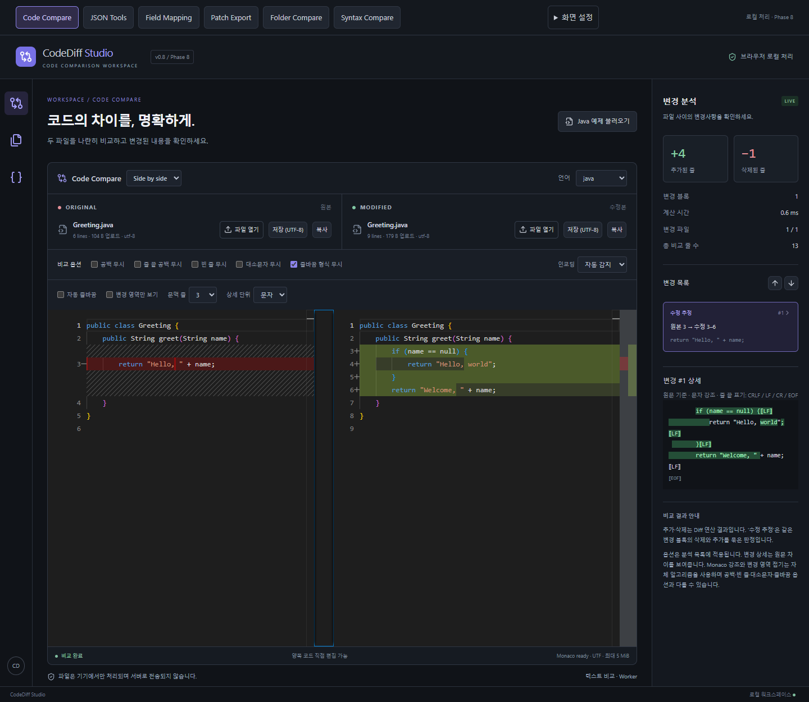
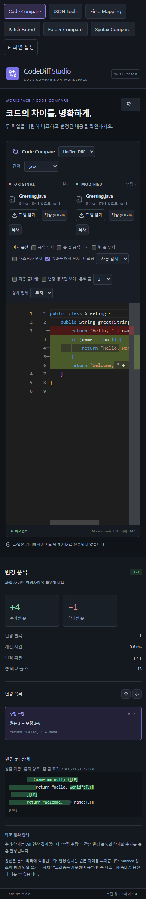

# CodeDiff Studio — 포트폴리오 소개

CodeDiff Studio는 소스 코드·프로젝트 폴더·구조화 데이터를 한 브라우저에서 비교하는 정적 웹 개발 도구다. 파일을 백엔드에 업로드하지 않고 편집·분석·내보내기를 수행한다.

[실행하기](https://heoseongbin.github.io/CodeDiff-Studio/) · [전체 요구사항](../PROJECT.md) · [검증표](RELEASE-CHECKLIST.md) · [ADR](DECISIONS.md)

## 사용하는 흐름

1. Code Compare에 수정 전후 파일을 올려 정확한 물리 줄과 변경 목록을 확인한다. 편집과 분석 옵션은 디스크 원본을 변경하지 않는다.
2. JSON은 구조 비교·트리·JSONPath·Schema·TypeScript·CSV로 탐색하고, Field Mapping에서 안전한 경로 기반 규칙으로 변환한다.
3. 폴더는 상대 경로·내용으로 비교한다. 바이너리는 바이트, 텍스트는 원문, 오류는 오류로 분리하며 선택 파일만 Code Compare에 명시적으로 전달한다.
4. 원문 기반 Patch를 생성하고 실제 적용 결과가 수정본과 정확히 일치할 때 저장한다. Java/C#/Python/JS/TS의 구문 변경은 Syntax Compare에서 별도로 확인한다.

## 설계에서 해결한 문제

- **정확성과 표시 분리:** Text/JSON/Folder/Syntax/Patch 엔진을 구분했다. 공백/EOL 옵션은 비교용 데이터에만 적용하며 저장·Patch는 원문을 사용한다. 수정·rename은 확정 사실과 휴리스틱 후보를 구분한다.
- **계산 수명:** Worker 요청id·입력 snapshot·취소·timeout으로 오래된 결과가 새 입력을 덮어쓰는 경합을 차단한다. 탭 비활성화와 idle 때 Worker를 정리하고, 페이지·가상 목록으로 DOM 크기를 제한한다.
- **Monaco 수명:** 공개 Diff view-model API로 소유·해제를 명시해 외부 입력 교체 시 이전 계산이 새 줄 번호를 참조하는 오류를 해결했다. 텍스트 모델을 재사용하고 StrictMode의 시험 mount에서 불필요한 Worker를 생성하지 않는다.
- **정적 배포:** 소스 HTML 게시로 main.tsx404가 발생했던 원인을 확인하고 Vite dist artifact 배포로 변경했다. root 회귀와 실제 Pages 하위 경로 Worker/WASM·업로드·다운로드 검증을 분리했다.
- **검증 근거:** 독립 편집거리 oracle·고정 seed250 입력·원문 재구성, 실제 Git Patch 적용, 실제 브라우저와5개 로컬 grammar, 파일·폴더 원본 불변 및 네트워크 요청 감시를 결합했다.

## 기술과 범위

React18, strict TypeScript, Vite6, Tailwind4, Zustand, Monaco, jsdiff, Ajv, JSONPath Plus, Papa Parse, Tree-sitter WASM, Vitest, Playwright, GitHub Actions/Pages. 버전과 실제 의존성은 package.json/package-lock.json을 기준으로 한다. 사용하지 않는 백엔드나 실행 환경을 추가하지 않았다.

검증: 단위·통합351개, production Edge31개, 실제 Pages Edge8개. 성능 측정은 [PERFORMANCE](PERFORMANCE.md)의 환경·제한과 함께 읽어야 한다. 모바일 화면은 viewport emulation이며 실기기 검증은 아니다. 신규 원격 CI 실행 여부는 [PROGRESS](PROGRESS.md)의 최신 기록을 따른다.

## 화면

JSON 구조 비교와 Mapping·Folder·Syntax·Light 테마 화면은 README의 각 사용법에 포함되어 있다. 실제 배포 기능과 지원 범위를 넘어선 성능·접근성·의미 분석을 주장하지 않는다.
